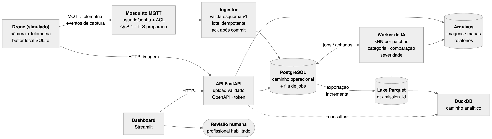

# FachadaGuard

**Triagem de anomalias em fachadas com drone, IoT, Big Data e IA** — projeto final da disciplina
*Internet das Coisas e Aplicações de IA (Big Data)*, Especialização em IA Aplicada (Unisinos), 2026/2.

> ⚠️ **Protótipo acadêmico de triagem e apoio à decisão.** Não é laudo de engenharia, diagnóstico estrutural
> nem inspeção normativa. Todo achado exige revisão por profissional habilitado. Os índices de anomalia não são
> probabilidades. **Drone, edifício, voos e imagens são simulados/sintéticos.**

| | |
|---|---|
| Integrantes | Matheus Vasconcellos · Daniel Nicol |
| Vídeo (pitch + demo) | PREENCHER |
| Relatório técnico | [`docs/relatorio_tecnico.pdf`](docs/relatorio_tecnico.pdf) |
| Licença | [MIT](LICENSE) |

## 1. Problema e proposta de valor

Fissuras que crescem, manchas de umidade e desplacamentos antecedem o desprendimento de componentes de
fachadas sobre áreas de circulação. Inspeções pontuais são caras e difíceis de comparar ao longo do tempo. O
FachadaGuard usa voos periódicos de drone para formar um **histórico por edifício, fachada e região**, detecta
regiões visualmente anômalas, **compara com a inspeção anterior**, prioriza o que mudou com uma regra
explicável e entrega à manutenção um painel e um relatório preliminar — sempre com **revisão humana**.

## 2. Arquitetura



Drone (simulado) → **MQTT** (Mosquitto, QoS 1, auth + ACL) → **ingestor** idempotente → **PostgreSQL** →
**worker de IA** (fila durável) → achados, comparações e alertas → **dashboard** Streamlit. A imagem vai por
**HTTP** (API FastAPI) com SHA-256 conferido contra o evento MQTT. Histórico exportado para **Parquet**
particionado e consultado com **DuckDB**. Detalhes: [`docs/arquitetura.md`](docs/arquitetura.md).

## 3. Tecnologias e justificativas

| Camada | Tecnologia | Por quê |
|---|---|---|
| Broker IoT | Eclipse Mosquitto 2.0 | leve, padrão MQTT, sessões persistentes, ACL |
| Ingestão | paho-mqtt (MQTT v5) + Pydantic | ack manual após commit, esquemas versionados |
| API | FastAPI + SQLAlchemy | OpenAPI automática, validação forte |
| Banco operacional / fila | PostgreSQL 16 | transações, `ON CONFLICT`, `SKIP LOCKED` |
| IA | OpenCV, scikit-image, scikit-learn | roda em CPU, reprodutível, sem pesos externos |
| Big Data | PyArrow (Parquet) + DuckDB | colunar, particionado, consultas rápidas num notebook |
| Interface | Streamlit + Plotly | entrega rápida de painel interativo |
| Execução | Docker Compose | sobe tudo com um comando, healthchecks, volumes |

## 4. Pré-requisitos

- Docker Desktop (ou Docker Engine) com Compose v2, ~6 GB livres em disco, 4 GB de RAM para o Docker.
- Para testes, avaliação e geração do PDF: Python 3.12 (`python3.12`).
- Portas livres: 1883 (MQTT), 8000 (API), 8501 (dashboard), 55432 (Postgres, só em `127.0.0.1`).

## 5. Instalação e caminho rápido da demo

```bash
cd fachadaguard            # raiz do projeto
make demo                  # cria .env, constrói e sobe a stack, voa as missões A e B,
                           # analisa, exporta para o lake e gera os relatórios (~2 min)
```

`make demo` executa, em ordem: `make up` → missão A (maio/2026) → aguarda as 6 análises → missão B
(novembro/2026) **com perda de enlace**, buffer local e reenvio de duplicatas → aguarda as 12 análises →
exportação Parquet → relatórios. Sem `make`, os mesmos passos estão no [`Makefile`](Makefile).

## 6. URLs locais e credenciais (somente demonstração)

| Serviço | URL / acesso |
|---|---|
| Dashboard | http://localhost:8501 |
| API + OpenAPI | http://localhost:8000/docs (saúde: `/health`, prontidão: `/ready`) |
| MQTT | `localhost:1883` · usuários `fg_drone` (publica) e `fg_ingestor` (lê); senhas em `.env` |
| Token de escrita da API | cabeçalho `X-API-Token: demo-token-troque` |

Todos os valores de `.env.example` são **exclusivamente de demonstração**. A porta MQTT 1883 não usa TLS na demo
local; veja como habilitar em [`docker/mosquitto/mosquitto.conf`](docker/mosquitto/mosquitto.conf).

## 7. Simulador e eventos

```bash
make simulate-a                 # voo normal (época A)
make simulate-outage            # época B, enlace cai a 35% do voo por 40 s lógicos, reenvia 15 mensagens
docker compose run --rm simulator mission --epoch B --seed 7 --speed 0   # parâmetros livres
docker compose run --rm simulator load --events 100000 --duplicate-rate 0.02
make logs                       # acompanhar ingestor e worker
```

Para observar as mensagens MQTT, use um cliente com as credenciais do `.env`, por exemplo
`mosquitto_sub -h localhost -u fg_ingestor -P <senha> -t 'fachadaguard/v1/#' -v`. Exemplo de payload de
telemetria e lista de tópicos em [`docs/arquitetura.md`](docs/arquitetura.md#2-tópicos-e-contratos-mqtt-fachadaguardschemasmqttpy).

## 8. Carregar uma imagem e comparar inspeções

- **Dashboard → Inspeções → "Enviar imagem manualmente"**: escolha missão, região e arquivo PNG/JPEG
  (até 15 MB). A análise entra na fila automaticamente.
- **Dashboard → Comparação temporal**: escolha a região e as duas inspeções → *Comparar*.
- Via API:

```bash
T=demo-token-troque
curl -H "X-API-Token: $T" -F file=@foto.png -F region_id=reg-demo-n-01 \
     http://localhost:8000/api/v1/missions/msn-demo-b/images
curl -H "X-API-Token: $T" -H 'Content-Type: application/json' \
     -d '{"before_inspection_id":"<id>","after_inspection_id":"<id>"}' http://localhost:8000/api/v1/comparisons
curl -H "X-API-Token: $T" -H 'Content-Type: application/json' \
     -d '{"status":"confirmado","note":"verificado na imagem"}' http://localhost:8000/api/v1/findings/<id>/review
```

Mais exemplos: [`docs/exemplos_api.http`](docs/exemplos_api.http).

## 9. Testes, avaliação, benchmark e relatórios

```bash
make setup                 # .venv local (dev + dashboard + docs)
make test                  # testes unitários e de integração local (SQLite) + cobertura
make test-integration      # smoke test contra a stack Docker em execução
make lint typecheck        # ruff + mypy
make dataset               # dataset sintético em data/synthetic com manifesto e checksums
make evaluate              # métricas → artifacts/evaluation/ (~2,5 min)
make benchmark             # 100 mil eventos → artifacts/benchmark/latest.json (~35 s)
make benchmark-large       # opcional: 1 milhão de eventos
make reports               # relatório preliminar HTML de cada missão (também pelo dashboard)
```

Resultados da última execução (dados **sintéticos**; números completos e gerados automaticamente no relatório
§12):

| Medida | Valor |
|---|---|
| Testes | 65 locais + 4 smoke contra a stack, todos passando; cobertura do núcleo 92% |
| Detecção (teste, 120 imagens) | AUROC imagem 0,908 · AUROC pixel 0,941 · FPR no limiar 16,3% |
| Recall por tipo | desplacamento 38/38 · fissura 25/33 · mancha de umidade 4/26 |
| Comparação temporal | 0/10 pares incompatíveis aceitos; 2/10 deslocamentos grandes recusados com segurança |
| Benchmark | 100.000 eventos únicos em 17,3 s (≈ 5.780 eventos/s); 1.957/1.957 duplicatas descartadas |

## 10. Estrutura do projeto

```text
apps/api/               API FastAPI (OpenAPI em /docs)
apps/dashboard/         dashboard Streamlit
services/mqtt_ingestor/ consumidor MQTT idempotente
services/ai_worker/     worker de IA (fila durável) + exportação ao lake
simulator/              drone simulado (missão, perda de enlace, carga)
fachadaguard/           núcleo: domain, schemas, storage, vision, analytics, reporting, ingestion, pipeline
scripts/                dataset, avaliação, benchmark, passos da demo, documentação
tests/                  unit/, integration/ (SQLite), e2e/ (stack Docker)
docker/mosquitto/       configuração, ACL e entrypoint do broker
docs/                   arquitetura, metodologia, dataset card, diagramas e relatório técnico (PDF)
artifacts/              resultados regeneráveis (avaliação, benchmark)
```

## 11. Modelo e dados

- **Dados:** 100% sintéticos, gerados por código com sementes fixas (fachadas com juntas, janelas e iluminação;
  fissuras, manchas e desplacamentos com máscaras). Ficha: [`docs/dataset_card.md`](docs/dataset_card.md).
- **Modelo:** detector one-class kNN sobre 31 características clássicas por patch (cor Lab relativa, gradientes,
  LBP, black-hat, bordas, Laplaciano), limiar calibrado em referências normais separadas; categoria candidata por
  heurística explicável; comparação ORB/ECC + SSIM; severidade por regra de pontos. Metodologia:
  [`docs/metodologia.md`](docs/metodologia.md). Cada execução registra versão do modelo, parâmetros e hash do
  conjunto de referência.

## 12. Limitações e trabalho futuro

Desempenho medido apenas em dados sintéticos; manchas de umidade e sombras são confundidas (trade-off quantificado
na ablação); categorias são heurísticas; sem anonimização automática; TLS desligado na demo local; sem backend de
embeddings pré-treinados. Próximos passos: dados reais autorizados e rotulados por especialistas, calibração por
fachada, embeddings pré-treinados, contexto global (sombras/janelas) e anonimização validada. Ver relatório §13–§15.

## 13. Segurança e privacidade

Broker sem acesso anônimo (usuário/senha + ACL por papel), token para rotas de escrita, validação de upload por
conteúdo real, nomes internos gerados, proteção contra *path traversal*, segredos apenas em `.env` (fora do Git),
logs sem segredos, dead-letter para payloads inválidos. Para uso real: TLS, anonimização antes do armazenamento,
retenção limitada, controle de acesso e observância da LGPD e das regras de ANAC, DECEA e Anatel — fontes oficiais
e recomendações no relatório §11.
