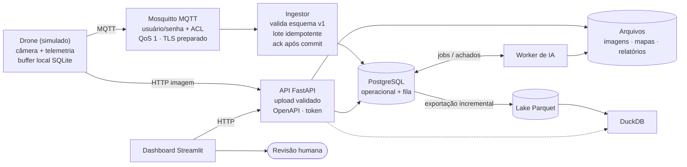
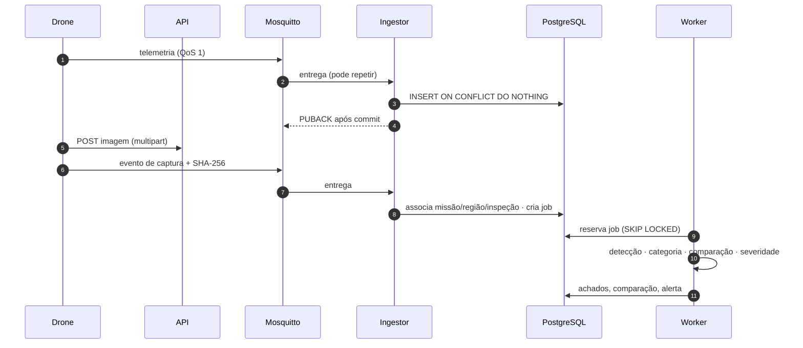

# Arquitetura do FachadaGuard

Fontes Mermaid versionadas em [`diagramas/`](diagramas/); versões SVG/PNG em [`img/`](img/) geradas por
`make docs`.

## 1. Componentes



| Processo | Código | Responsabilidade |
|---|---|---|
| `mosquitto` | `docker/mosquitto/` | broker MQTT com autenticação, ACL e persistência de sessões |
| `ingestor` | `services/mqtt_ingestor/main.py` | consome tópicos v1, valida, persiste em lote, confirma após commit |
| `api` | `apps/api/main.py` | REST v1, upload binário, comparação, relatórios, analítica, OpenAPI em `/docs` |
| `worker` | `services/ai_worker/main.py` | fila durável de análises, treino/carga do modelo, exportação periódica ao lake |
| `dashboard` | `apps/dashboard/app.py` | interface operacional (consome só a API) |
| `simulator` | `simulator/drone.py` | drone simulado, perda de enlace, carga acelerada (perfil `tools`) |
| núcleo | `fachadaguard/` | domínio, esquemas, ingestão, visão, severidade, analítica, relatórios |

## 2. Tópicos e contratos MQTT (`fachadaguard/schemas/mqtt.py`)

| Tópico | Esquema | QoS | Conteúdo |
|---|---|---|---|
| `fachadaguard/v1/drones/{drone_id}/telemetry` | `TelemetryV1` | 1 | posição, altitude, bateria, velocidade, rumo, qualidade de sinal, estado |
| `fachadaguard/v1/missions/{mission_id}/captures` | `CaptureEventV1` | 1 | metadados da foto + SHA-256 + região da fachada |
| `fachadaguard/v1/missions/{mission_id}/status` | `MissionStatusV1` | 1 | `in_progress` / `completed` / `aborted` |

Campos obrigatórios em todas as mensagens: `event_id`, `schema_version` ("1.0"), `drone_id`, `mission_id`,
`captured_at` (com timezone; normalizado para UTC). `extra="forbid"`, limite de 16 KiB por payload, IDs do
tópico precisam coincidir com os do corpo. Rejeições vão para a tabela `dead_letters` (trecho truncado).

Exemplo de telemetria:

```json
{"event_id": "4f0c…", "schema_version": "1.0", "drone_id": "drn-sim-01", "mission_id": "msn-demo-a",
 "captured_at": "2026-05-12T13:00:30Z", "latitude": -30.0497, "longitude": -51.2603, "altitude_m": 12.0,
 "battery_pct": 96.8, "speed_mps": 3.0, "heading_deg": 180.0, "signal_quality": 88.5,
 "mission_state": "transit", "simulated": true}
```

## 3. Sequência: da captura ao alerta



## 4. Comparação entre inspeções

Ver [`diagramas/03_comparacao.mmd`](diagramas/03_comparacao.mmd): verificação de compatibilidade da região
→ ORB + homografia RANSAC validada → fallback ECC afim → recusa segura (`alignment_failed`) → casamento de
histograma → 1 − SSIM na área válida.

## 5. Modelo de dados

Ver [`diagramas/04_modelo_dados.mmd`](diagramas/04_modelo_dados.mmd). Entidades: edifício, fachada, região,
missão, inspeção (missão × região), evento de telemetria, captura, execução de modelo (job), achado,
revisão de achado, alerta, comparação, relatório, dead-letter e heartbeat de serviço. IDs textuais estáveis
com prefixo; timestamps `timestamptz` em UTC.

## 6. Caminhos de dados (Big Data)

| Caminho | Armazenamento | Uso |
|---|---|---|
| Velocidade / operacional | PostgreSQL | ingestão contínua, estado da missão, fila de jobs, revisão humana |
| Volume / histórico | Parquet zstd particionado `dt=…/mission_id=…` | agregações sobre milhões de eventos sem carregar o banco |
| Variedade | Postgres + volume de arquivos | telemetria estruturada, imagens, mapas de calor, relatórios HTML |
| Consulta analítica | DuckDB (`fachadaguard/analytics/lake.py`) | telemetria por missão, distribuições, eventos por dia, evolução de anomalias |

## 7. Segurança (resumo)

Token de API para rotas de escrita (`X-API-Token`), validação de upload (tipo real por *magic bytes*,
extensão, tamanho, decodificação, dimensões), nomes internos gerados pelo sistema, chaves de arquivo validadas
contra *path traversal*, segredos só em `.env` (não versionado), `safe_dict()` para logs sem segredos.
